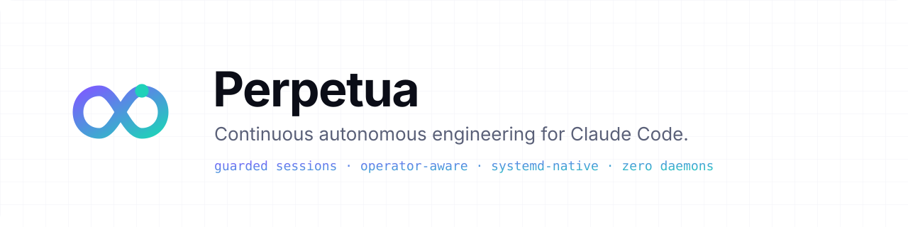
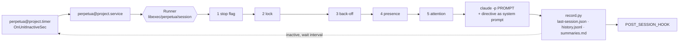

<p align="center">
  <picture>
    <source media="(prefers-color-scheme: dark)" srcset="assets/banner-dark.svg">
    
  </picture>
</p>

<p align="center">
  <a href="https://github.com/koffih/perpetua/actions/workflows/ci.yml"></a>
  <a href="https://koffih.github.io/perpetua/"></a>
  <a href="https://github.com/koffih/perpetua/releases"></a>
  <a href="LICENSE"></a>
  
</p>

<p align="center">
  <a href="https://koffih.github.io/perpetua/getting-started/quickstart/"><b>Quickstart</b></a> ·
  <a href="https://koffih.github.io/perpetua/concepts/architecture/"><b>Architecture</b></a> ·
  <a href="https://koffih.github.io/perpetua/concepts/guardrails/"><b>Guardrails</b></a> ·
  <a href="https://koffih.github.io/perpetua/reference/cli/"><b>CLI reference</b></a> ·
  <a href="https://koffih.github.io/perpetua/security/threat-model/"><b>Threat model</b></a> ·
  <a href="README.fr.md"><b>Français</b></a>
</p>

---

**Perpetua keeps a software project moving while nobody is at the keyboard.** It starts a fresh, unattended [Claude Code](https://claude.com/claude-code) session on your repository, lets it work through your plan for hours, records what it did, waits, and starts the next one. Night after night, without a daemon, without an API key, and without ever stepping on your own work.

Every session passes through five admission gates enforced in code, receives a standing directive you own, and leaves a machine-readable record and a human-readable report behind. Scheduling is delegated to systemd. The whole runtime is two small, audited files.

```console
$ perpetua status
atlas
  project        /srv/work/atlas
  cadence        enabled, next Tue 2026-10-20 18:07:24
  state          ready
  last session   ok (2026-10-20T17:07:24-04:00)
  last wake-up   2026-10-20 17:07:24 session:end 20261020T170724 outcome=ok exit=0 duration=212min
```

## Why Perpetua

| | |
|---|---|
| **Fresh context, durable state** | Each session starts from a clean context window and rebuilds its understanding from the repository: plan, progress notes, git history, open pull requests. No context rot, no hidden memory, nothing that a human cannot read. |
| **Guardrails in code, not in prompts** | Stop flag, exclusivity lock, usage-limit back-off, operator presence and attention throttling are enforced by the runner before Claude is ever started. `--force` cannot bypass the safety gates. |
| **Operator-aware** | If you used Claude Code in the last ten minutes, Perpetua yields. You and the agent never edit the same files at the same time. Its own transcripts are recognised and never mistaken for yours. |
| **Ask once, keep shipping** | When the agent needs a decision only you can make, it writes one question in your plan and continues on independent work. While it waits, sessions are throttled so your quota is not burned on a blocked plan. |
| **Systemd-native, zero daemons** | A template service and timer per project, journald logging, lingering for logged-out operation. Nothing to supervise, nothing resident between sessions. |
| **Runs on your subscription** | Uses the Claude Code login you already have. No metered API key is required, and usage limits are detected and absorbed with an automatic back-off. |
| **Auditable by design** | `history.jsonl` for machines, `summaries.md` for humans, full stream-json journals with retention, and a post-session hook for your alerting. |

## How it works



1. The timer fires a fixed interval **after the previous run ended**, so sessions never overlap and long sessions never queue up.
2. The runner evaluates its gates in order. Any closed gate ends the run cleanly with status `0`, keeping the cadence intact.
3. Claude Code runs headless in the project directory with your prompt (by default `/autonomous-mode follow the plan`) and your directive appended to its system prompt, under a hard time ceiling.
4. The outcome (`ok`, `error`, `timeout`, `rate_limited`, `interrupted`) is classified, recorded, and handed to your hook.

The real quality gate is your own engineering process: the directive requires branches, pull requests and a green CI before anything merges. Perpetua makes that process run around the clock.

## Quickstart

**Requirements:** Linux or WSL2 with a systemd user instance, bash 4+, Python 3.8+, `flock`, `timeout`, and Claude Code logged in. The [`autonomous-mode`](https://github.com/koffih/claude-skill-autonomous-mode) skill is recommended.

```bash
# 1. Install into ~/.local
curl -fsSL https://raw.githubusercontent.com/koffih/perpetua/main/install.sh | bash
perpetua doctor

# 2. Register a project: writes its configuration and scaffolds .perpetua/directive.md
perpetua init ~/work/atlas

# 3. Review the directive, then run one supervised session
perpetua run atlas --force

# 4. Start the cadence: a new session 30 minutes after each one ends
perpetua enable atlas --interval 30min
loginctl enable-linger "$USER"   # keep running when you log out
```

The next morning:

```bash
perpetua status            # cadence, gates and last outcome for every project
perpetua summaries atlas   # what the agent says it did
perpetua logs atlas        # one line per wake-up, including skipped ones
perpetua pause atlas       # stop starting new sessions; resume with: perpetua resume atlas
```

Full walkthrough: [Quickstart](https://koffih.github.io/perpetua/getting-started/quickstart/).

**On a headless VPS**, one command as root prepares a dedicated account, Claude Code, a token-based login and a deploy key: `./platform/vps/bootstrap.sh --oauth-token-file claude-token --repo git@github.com:you/atlas.git`. See [Running on a VPS](https://koffih.github.io/perpetua/guides/vps/).

## Guardrails at a glance

| Gate | Closes when | Bypassed by `--force` |
|---|---|---|
| **Stop** | `perpetua pause`, or a `.perpetua/STOP` file in the project | Never |
| **Lock** | A session for this project is already running | Never |
| **Back-off** | A usage limit was reported less than `BACKOFF_SECONDS` ago | Never |
| **Presence** | You used Claude Code within `PRESENCE_WINDOW_MIN` minutes | Yes |
| **Attention** | A question waits in your plan and a session already ran within `QUESTION_THROTTLE_SECONDS` | Yes |

Inside the session, the shipped directive forbids purchases and sign-ups, publishing outside your repositories, pushing to the default branch, force-pushing, merging on a red check, deleting non-test data, committing secrets, and editing `.perpetua/`. Read the [guardrails model](https://koffih.github.io/perpetua/concepts/guardrails/) and the [threat model](https://koffih.github.io/perpetua/security/threat-model/) before enabling Perpetua on anything that matters.

## Documentation

| Section | |
|---|---|
| [Getting started](https://koffih.github.io/perpetua/getting-started/installation/) | Installation, first supervised session, enabling the cadence |
| [Concepts](https://koffih.github.io/perpetua/concepts/architecture/) | Architecture, session lifecycle, guardrails |
| [Guides](https://koffih.github.io/perpetua/guides/writing-a-directive/) | Writing a directive, day-2 operations, notifications, multiple projects, WSL, VPS |
| [Reference](https://koffih.github.io/perpetua/reference/cli/) | CLI, configuration keys, files and state, runner log, systemd units |
| [Security](https://koffih.github.io/perpetua/security/threat-model/) | Threat model and hardening checklist |
| [Architecture decisions](https://koffih.github.io/perpetua/adr/) | The reasoning behind every structural choice |

## Repository layout

```text
bin/perpetua                     CLI: init, enable, run, status, pause, doctor...
libexec/perpetua/session         the guarded runner, one session per invocation
libexec/perpetua/record.py       outcome recorder (Python standard library only)
share/perpetua/systemd/          perpetua@.service and perpetua@.timer templates
share/perpetua/templates/        project configuration and directive templates
platform/wsl/                    Windows-side keep-alive for WSL2 hosts
platform/vps/bootstrap.sh        fresh server to Perpetua host in one command
share/perpetua/skills/           bundled autonomous-mode skill
tests/                           bats suite with fake claude and systemctl
docs/                            documentation site (Material for MkDocs)
```

## Provenance

Perpetua was extracted from an autonomous engineering loop that has run in production since October 2026 on a large private, multi-repository codebase, where unattended sessions carry a phased plan forward through branches, pull requests and continuous integration. Every gate in the runner exists because a real night needed it.

## Contributing

Issues and pull requests are welcome. Read [CONTRIBUTING.md](CONTRIBUTING.md) for the development setup, coding standards and release process, and [SECURITY.md](SECURITY.md) to report a vulnerability privately.

```bash
make test    # bats suite, no Claude session consumed
make lint    # shellcheck and Python checks
make docs    # strict documentation build
```

## License

Copyright 2026 The Perpetua Authors. Licensed under the [Apache License, Version 2.0](LICENSE).

Claude and Claude Code are products of Anthropic. Perpetua is an independent project and is not affiliated with or endorsed by Anthropic.
