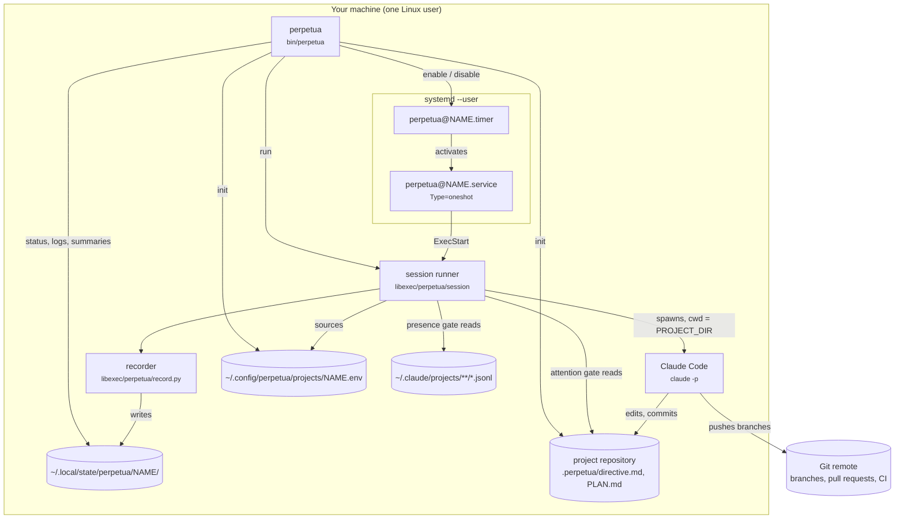

# Architecture

Perpetua is deliberately small. There is no server, no database and no long-running process of its own. systemd decides **when** to wake up, a short-lived runner decides **whether** a session may start, Claude Code does the work, and a recorder writes down what happened. Everything else is files.

## Components



### `perpetua` (CLI)

The operator interface: register projects (`init`, `remove`), manage the cadence (`enable`, `disable`), operate (`run`, `pause`, `resume`) and observe (`status`, `list`, `logs`, `summaries`, `doctor`). It never runs a session itself: `perpetua run` replaces itself with the runner (`exec`), so a supervised run and a timer run are the same code path. See the [CLI reference](../reference/cli.md).

### systemd units

Two template units, installed into `~/.config/systemd/user/` by `perpetua enable`, one instance per project (`%i` is the project name):

- `perpetua@.timer` fires `OnBootSec=10min` and then `OnUnitInactiveSec=15min`: a fixed delay after the previous run **finished**. A per-project drop-in written by `enable --interval` overrides the delay.
- `perpetua@.service` is a `Type=oneshot` unit whose `ExecStart` is the runner. `TimeoutStartSec=infinity` because the runner enforces its own limit; `Nice=5` and best-effort I/O priority keep an interactive desktop responsive.

Because the delay counts from the end of the previous activation, sessions cannot overlap and missed wake-ups do not queue. See the [systemd reference](../reference/systemd.md).

### Session runner

`libexec/perpetua/session` is a bash script of under 200 lines. On every wake-up it:

1. sources the project configuration over built-in defaults;
2. evaluates the five [admission gates](guardrails.md) in a fixed order, exiting 0 at the first one that closes;
3. builds the `claude -p` command line, runs it in `PROJECT_DIR` under `timeout` as a background child, registers its session id in `own-sessions` as soon as Claude Code announces it, and forwards `SIGTERM` to it if the runner itself is stopped;
4. classifies the outcome, calls the recorder, prunes old journals and runs the post-session hook.

### Recorder

`libexec/perpetua/record.py` (Python standard library, 3.8+) reads the stream-json journal of the session and writes `last-session.json`, appends to `history.jsonl` and `summaries.md`, and adds the Claude Code session id to `own-sessions` if the runner has not already registered it, so the presence gate never mistakes Perpetua's own transcripts for the operator.

### Claude Code

The agent. Perpetua invokes it as:

```bash
claude -p "$PROMPT" --output-format stream-json --verbose $CLAUDE_ARGS \
  [--model "$MODEL"] --append-system-prompt "$(cat .perpetua/directive.md)"
```

with standard input closed and the working directory set to `PROJECT_DIR`. Perpetua does not wrap, proxy or reimplement any part of Claude Code; it uses the CLI and the login you already have.

## File layout

```text
~/.local/bin/perpetua                     CLI
~/.local/libexec/perpetua/
├── session                               runner
└── record.py                             recorder
~/.local/share/perpetua/
├── systemd/perpetua@.service             unit templates
├── systemd/perpetua@.timer
└── templates/{project.env,directive.md}  used by perpetua init

~/.config/perpetua/projects/NAME.env      project configuration
~/.config/systemd/user/
├── perpetua@.service                     rendered by perpetua enable
├── perpetua@.timer
└── perpetua@NAME.timer.d/10-interval.conf

~/.local/state/perpetua/NAME/             project state
├── runner.log                            one line per decision
├── last-session.json                     latest session record
├── history.jsonl                         every session record
├── summaries.md                          closing reports
├── own-sessions                          Claude Code session ids launched by Perpetua
├── sessions/YYYYMMDDTHHMMSS.jsonl        raw stream-json journals
├── lock                                  flock target
├── paused                                present while paused
├── backoff-until                         epoch seconds, after a usage limit
└── last-question-run                     epoch seconds, attention gate

PROJECT_DIR/.perpetua/
├── directive.md                          standing order (commit it)
├── .gitignore                            ignores STOP
└── STOP                                  present: no session starts
```

`XDG_CONFIG_HOME` and `XDG_STATE_HOME` are honoured. Every file is described in [State and files](../reference/state-and-files.md).

## Design principles

**Fresh context, every session.**
A session never resumes the previous conversation. It starts clean and rebuilds its understanding from the plan, the progress notes and the state of the repository. Continuity lives in files and in git, where the operator can read and correct it, not in a context window that degrades over hours. See [ADR 0001](../adr/0001-fresh-context-per-session.md).

**No daemon.**
systemd already solves scheduling, restarts after boot, logging and resource control. Perpetua adds a short-lived process that exits after every wake-up, so there is nothing to supervise, nothing to leak and nothing to restart after an upgrade. See [ADR 0002](../adr/0002-systemd-user-timers.md).

**The human owns the loop.**
The configuration lives outside the repository. The directive and `.perpetua/` live inside it, but the shipped directive forbids the agent to edit them. The operator decides what runs, when, and under which rules; the agent decides how to do the task in front of it.

**Fail closed, never stall.**
Every gate closes on doubt, and every closed gate exits 0, so systemd never marks the unit failed and the cadence simply tries again later. A broken night costs a few log lines, not a stuck loop. See [ADR 0006](../adr/0006-fail-closed-gates.md).

**Works on a subscription.**
Perpetua drives the logged-in Claude Code CLI. No API key is required, and a usage limit is treated as a normal event that triggers a back-off rather than an error. See [ADR 0003](../adr/0003-subscription-auth.md).

**Yield to the operator.**
If the human used Claude Code recently, the agent stands down. The two never edit the same working tree at the same time. See [ADR 0004](../adr/0004-operator-presence-yield.md).

**Ask once, keep working.**
When the agent needs a decision only the operator can make, it writes the question in the plan and continues with independent tasks. While the question stays open, the attention gate limits sessions to one per throttle period, so quota is not burned waiting for an answer.

**Plain, auditable code.**
Bash and the Python standard library, no packages to install, no network calls of its own. The whole runtime fits in one screen per file and is covered by a [bats](https://github.com/bats-core/bats-core) test suite against a fake Claude Code.
