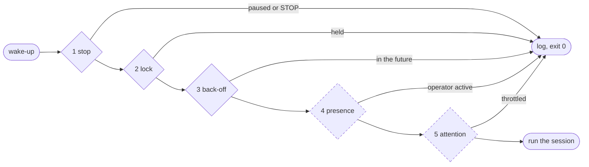

# Guardrails

Running an agent unattended is a question of trust boundaries. Perpetua draws them in two layers, and is explicit about which is which:

-   :material-lock-outline:{ .lg .middle } __Runner gates: enforced by code__

    ---

    Five checks in the session runner decide whether a session may **start**. They cannot be argued with: the agent never sees them and cannot change them.

-   :material-script-text-outline:{ .lg .middle } __Directive rules: enforced by the agent__

    ---

    The standing order appended to the system prompt tells the agent what it may **do** during a session. The model follows it, but nothing in Perpetua mechanically prevents a violation.

A third layer sits outside Perpetua entirely and is the one that matters most: your git host. Branch protection, pull requests and CI decide what actually reaches your default branch.

## Layer 1: runner gates

The gates run in a fixed order on every wake-up. The first one that closes writes one line to `runner.log` (and journald) and ends the run with exit status 0, so systemd keeps the cadence and tries again after the next interval. A closed gate never counts as a failure.

Dashed gates are skipped by `--force`.

### Gate 1: stop

Closes when either of these exists:

- `~/.local/state/perpetua/NAME/paused`, created by `perpetua pause NAME` and removed by `perpetua resume NAME`;
- `PROJECT_DIR/.perpetua/STOP`, a file anyone with access to the working tree can create (`touch .perpetua/STOP`). `.perpetua/.gitignore` keeps it out of commits.

Log line: `gate:stop paused by operator`.

The two switches exist for different hands. `pause` is the operator's command line switch. `STOP` lives next to the code, so it works from an editor, a file manager, a remote shell or a script, without Perpetua installed.

Neither switch interrupts a running session. To stop one immediately, see [Operating: stopping a running session](../guides/operating.md#stopping-a-running-session).

### Gate 2: lock

The runner takes a non-blocking `flock` on `state/lock` and holds it for its whole life, which spans the Claude Code process. The lock descriptor is closed for Claude Code and for the post-session hook, so background processes they leave behind never keep a project locked. A second runner for the same project (the timer firing while you run `perpetua run`, for example) finds the lock held and exits.

Log line: `gate:lock a session is already running`.

The lock is per project. Two different projects can run at the same time (see [Multiple projects](../guides/multiple-projects.md)).

### Gate 3: back-off

When a session is classified `rate_limited`, the runner writes `backoff-until` (epoch seconds: end of session + `BACKOFF_SECONDS`, 3600 by default). Until that moment, every wake-up closes here.

Log line: `gate:backoff usage limit, waiting until 2026-10-21 06:31:02`.

An expired or unreadable `backoff-until` is deleted and the gate opens. `perpetua resume NAME` deletes it immediately.

### Gate 4: operator presence

Claude Code writes a transcript (`*.jsonl`) under `~/.claude/projects/` for every session, interactive or not. The runner lists the transcripts modified within the last `PRESENCE_WINDOW_MIN` minutes (10 by default) anywhere under `PRESENCE_DIR`, removes those that belong to a session listed in the `own-sessions` file of **any** Perpetua project, and closes if anything remains. A transcript belongs to session `ID` when its path contains `/ID.jsonl` (the session itself) or `/ID/` (its subagents, under `ID/subagents/agent-*.jsonl`).

The runner adds a session id to `own-sessions` as soon as Claude Code announces it, a few seconds into the session. A Perpetua session that is still running is therefore never mistaken for you, by its own project or by any other.

Log line: `gate:presence operator active in Claude Code within 10 min, yielding`.

The effect: while you are working with Claude Code, on any project, Perpetua does not start a session. You and the agent never edit the same working tree at the same time, and you never share the subscription quota with a background agent while you need it. Ten minutes after your last interaction, the next wake-up proceeds.

The gate is skipped when `PRESENCE_WINDOW_MIN=0` or when `PRESENCE_DIR` does not exist.

!!! note "Presence means Claude Code"
    The gate only sees Claude Code transcripts. Editing files in your editor, running tests or using git does not count as presence. If you work on the project without Claude Code, `perpetua pause` it.

### Gate 5: attention

Implements a simple contract: *ask once, keep working on independent tasks, do not burn quota while waiting.*

When `QUESTION_FILE` is set (the template sets `PLAN.md`; a relative path is resolved against `PROJECT_DIR`, an absolute one is used as is) and readable, the runner takes the **first** line of it matching `QUESTION_PATTERN` (an extended regular expression, default `Pending question[*_ ]*:`, which requires the colon, optionally after Markdown emphasis). It extracts the value after the first colon, strips leading `*` or `_` and trailing spaces, and compares it, case-insensitively, with `QUESTION_NONE` (default `^(none|n/?a|-|aucune)?[.]?$`).

| Line in `PLAN.md` | Value | Question pending? |
| --- | --- | --- |
| `Pending question: none` | `none` | no |
| `**Pending question:** N/A.` | `N/A.` | no |
| `Pending question:` | empty | no |
| `**Pending question:** Stripe or Adyen for payments? Recommendation: Stripe.` | the question | **yes** |
| `## Pending questions` (heading, no colon) | does not match the pattern | no |
| no matching line | | no |

When a question is pending, the gate allows one session per `QUESTION_THROTTLE_SECONDS` (21600, six hours, by default) and records the time of that session in `last-question-run`. The session that is allowed through can still work on tasks that do not depend on the answer. The others close with:

`gate:attention question pending for the operator, next session after 2026-10-21 09:12:40`.

As soon as you answer and reset the line to `none`, the gate is open again.

### What `--force` bypasses

`perpetua run NAME --force` (or `PERPETUA_FORCE=1` in the environment of the runner) is meant for a human at the keyboard who wants a session now.

| Gate | Skipped by `--force`? | Why |
| --- | --- | --- |
| 1 stop | **never** | A stop is an explicit operator decision. Resume first. |
| 2 lock | **never** | Two sessions in one working tree corrupt each other's work. |
| 3 back-off | **never** | The limit is real; a forced session would fail against it. Clear it with `perpetua resume` if you know better. |
| 4 presence | yes | You are present by definition, and you asked. |
| 5 attention | yes | You are the one who would answer the question. |

`--force` also changes nothing about the session itself: same `MAX_SESSION`, same directive, same recording.

### Limits on the session itself

Beyond admission, the runner bounds every session:

- **Time**: `timeout --kill-after=60 MAX_SESSION` (4 hours by default). `SIGTERM` at the limit, `SIGKILL` 60 seconds later.
- **Input**: standard input is `/dev/null`. The session cannot wait for a human.
- **Working directory**: `PROJECT_DIR`.
- **Priority**: `Nice=5` and best-effort I/O class at priority 6 in the systemd unit.
- **Retention**: at most `SESSION_RETENTION` journals are kept.

## Layer 2: directive rules

The directive (`.perpetua/directive.md`) is appended to the system prompt of every session with `--append-system-prompt`. The shipped template sets the rules that made unattended work trustworthy in production:

- never ask in the conversation, because nobody will answer;
- finish unfinished work before starting new work;
- one branch and one pull request per task, never push to the default branch, never force-push, never merge with a failing check;
- no purchase, subscription or sign-up, no publishing outside the project's repositories;
- no deleting data other than test or demo data, no secret in the repository;
- do not edit `.perpetua/`: the operator owns the loop;
- record high-impact questions in the plan, then continue with independent tasks;
- end with a short report.

These rules are effective: models follow system prompt instructions well, and this one is short and unambiguous. They are still **instructions, not enforcement**. A misunderstanding, a prompt injection in a file the agent reads, or a model error can break any of them. See [Writing a directive](../guides/writing-a-directive.md) and the [threat model](../security/threat-model.md).

## Layer 3: your git host

Treat every Perpetua session as an untrusted contributor whose work arrives as a pull request:

- **Protect the default branch.** Require pull requests and passing status checks; disallow force pushes. This turns "never push to main" from a request into a fact.
- **Make CI the judge.** The agent opens the pull request; CI and you decide if it merges. A test suite that actually covers the behaviour is the strongest guardrail you have.
- **Scope credentials.** The session uses whatever git and `gh` credentials your user has. A fine-grained token limited to the project's repositories bounds the damage of any mistake.
- **Keep secrets out of reach.** Anything readable by your user is readable by the session.

## Honest limits

Perpetua does not:

- **Sandbox the agent.** With the default `--dangerously-skip-permissions`, a session can run any command your Linux user can. If you need isolation, run Perpetua under a dedicated user, in a container or in a VM, or replace `CLAUDE_ARGS` with a stricter permission mode (for example `--permission-mode acceptEdits` together with allow rules in the project's `.claude/settings.json`).
- **Inspect what the agent does.** It records the full journal for review, but makes no decision based on it except the usage limit pattern.
- **Detect presence outside Claude Code.** See gate 4.
- **Interrupt a session for a pause.** `pause` and `STOP` act on the next wake-up. To stop a running session, stop its service: it is recorded as `interrupted`.
- **Guarantee classification.** `rate_limited` is detected by matching `LIMIT_PATTERN` against what Claude Code reports as a failure (its error and rate limit events, a `result` flagged `"is_error":true`, and its standard error), never against tool output or a successful closing report. If Claude Code changes the wording of its limit messages, adjust the pattern.
- **Record a crash.** A power loss or a machine crash ends the session without a record; only signals the runner can trap produce an `interrupted` record.

The gates make the loop predictable. The directive makes the agent cooperative. Branch protection and CI make the result safe. Use all three.
