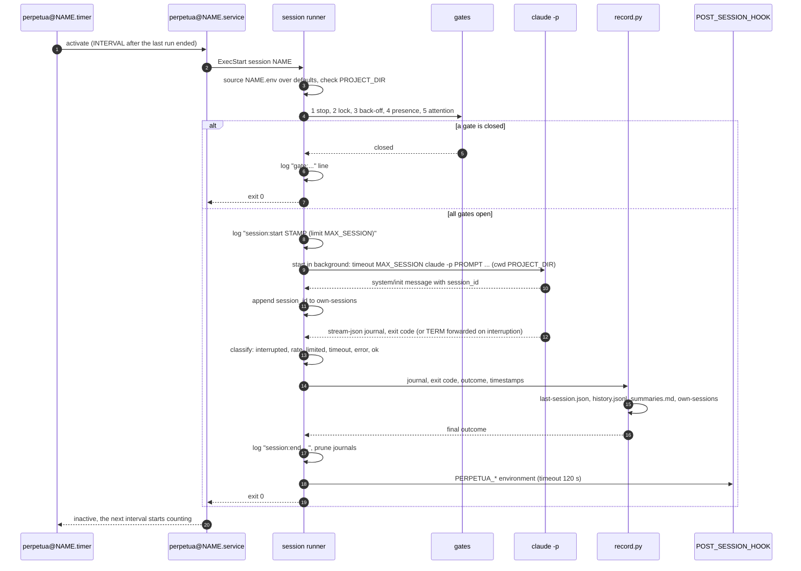
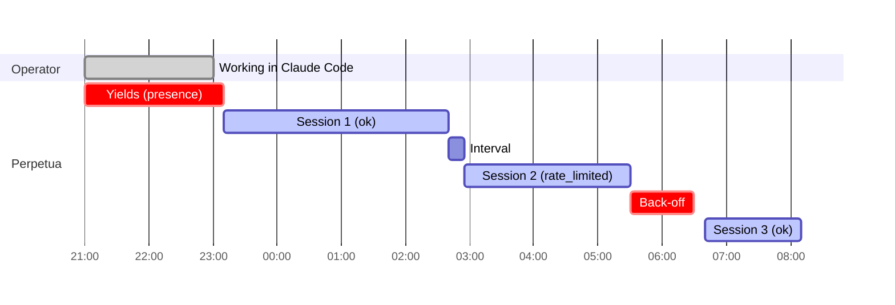

# Session lifecycle

Every wake-up follows the same path, whether it comes from the timer or from `perpetua run`. This page describes that path step by step and explains how the five session outcomes are decided.

## Sequence



## Step by step

### 1. Wake-up

The timer activates `perpetua@NAME.service` 10 minutes after boot, then `OnUnitInactiveSec` (15 minutes by default, or the `--interval` given to `enable`) after each activation ends. Because the delay counts from the end of the previous run, a long session simply pushes the next wake-up back.

`perpetua run NAME` enters at the next step directly, in your terminal.

### 2. Configuration

The runner validates the project name, sources `~/.config/perpetua/projects/NAME.env` over its built-in defaults, prepends the usual user binary directories to `PATH`, and creates the state directory. If `PROJECT_DIR` is empty or missing, it logs `error: project directory '...' not found` and exits 3: this is a configuration error, and systemd shows the unit as failed.

### 3. Admission gates

Five gates, always in this order. The first one that closes writes a single line to the runner log and ends the run with exit status 0. The details of each are in [Guardrails](guardrails.md).

| Order | Gate | Closes when | Log line |
| --- | --- | --- | --- |
| 1 | stop | `state/paused` or `PROJECT_DIR/.perpetua/STOP` exists | `gate:stop paused by operator` |
| 2 | lock | another run of the same project holds `state/lock` | `gate:lock a session is already running` |
| 3 | back-off | `state/backoff-until` is in the future | `gate:backoff usage limit, waiting until ...` |
| 4 | presence | a Claude Code transcript not launched by Perpetua changed within `PRESENCE_WINDOW_MIN` | `gate:presence operator active in Claude Code within N min, yielding` |
| 5 | attention | a pending question exists and a session already ran within `QUESTION_THROTTLE_SECONDS` | `gate:attention question pending for the operator, next session after ...` |

`--force` (or `PERPETUA_FORCE=1`) skips gates 4 and 5 only.

### 4. The session

The runner checks that `CLAUDE_BIN` is on `PATH` (otherwise it logs `error: 'claude' not found in PATH` and exits 2), then builds the command:

```bash
cmd=("$CLAUDE_BIN" -p "$PROMPT" --output-format stream-json --verbose $CLAUDE_ARGS) # (1)!
[[ -n $MODEL ]] && cmd+=(--model "$MODEL") # (2)!
[[ -r $directive ]] && cmd+=(--append-system-prompt "$(cat "$directive")") # (3)!
cd "$PROJECT_DIR" && timeout --kill-after=60 "$MAX_SESSION" "${cmd[@]}" < /dev/null
```

1. `CLAUDE_ARGS` is split on whitespace. The default is `--dangerously-skip-permissions`.
2. Only when `MODEL` is not empty.
3. `directive` is `DIRECTIVE_FILE`, resolved against `PROJECT_DIR` when relative. When it is not readable, the runner logs `warning: no directive at ..., the session runs on its prompt alone` and continues.

Standard output and standard error both go to `state/sessions/YYYYMMDDTHHMMSS.jsonl`, the session journal. When `MAX_SESSION` elapses, `timeout` sends `SIGTERM`, then `SIGKILL` 60 seconds later if the process is still alive.

The command runs in the background while the runner keeps two duties:

- **Registering the session.** The runner polls the journal (every half second, for up to two minutes) for the first `"session_id"` that Claude Code announces, and appends it to `state/own-sessions` immediately. From that moment, the presence gate of every Perpetua project ignores this session's transcripts, including those of its subagents, while it is still running.
- **Handling interruption.** The runner traps `SIGTERM`, `SIGINT` and `SIGHUP` (`systemctl --user stop`, `Ctrl-C` on `perpetua run`, a closed terminal). On any of them it forwards `SIGTERM` to the session, waits for it to exit, and records the session as `interrupted` with exit status 130.

### 5. Classification

As soon as Claude Code exits, the runner assigns a provisional outcome, checking in this order:

| Outcome | Condition | Side effect |
| --- | --- | --- |
| `interrupted` | The runner received `SIGTERM`, `SIGINT` or `SIGHUP` during the session; the exit status is recorded as 130 | none |
| `rate_limited` | What Claude Code itself reported matches `LIMIT_PATTERN`, a case-insensitive extended regular expression (default below) | Writes `backoff-until` = end time + `BACKOFF_SECONDS` |
| `timeout` | Exit status 124 (`timeout` fired) or 137 (killed after the grace period) | none |
| `error` | Any other non-zero exit status | none |
| `ok` | Exit status 0 | none |

```text
usage limit|limit reached|rate_limit_error|"error":"rate_limit"
```

`LIMIT_PATTERN` is matched only against the journal lines that carry Claude Code's own reports of a failure: lines that are not JSON (its standard error), JSON lines that start with `{"type":"error"` or `{"type":"rate_limit"`, and `result` events flagged `"is_error":true`. Tool calls and tool output, where the agent may read any text, are never inspected, and neither is a successful `result`, so a closing report that mentions a usage limit does not trigger the back-off.

The recorder then refines it: an `ok` session whose journal contains no final `result` message, or whose `result` carries `"is_error": true`, becomes `error`. The recorder never upgrades an outcome, and never changes `interrupted`, `rate_limited` or `timeout`. When the recorder succeeds, the runner reads the final outcome back from `last-session.json` for the log line and the hook.

!!! note "Outcome is about the session, not the work"
    `ok` means Claude Code ran to completion and produced a final result. It says nothing about whether the task was done well. That judgement belongs to the closing report, the pull request and your CI.

??? info "Why `interrupted` and `rate_limited` come first"
    An interrupted session exits with whatever status the signal produced; classifying it first keeps a deliberate stop from being reported as an `error` or a `timeout`.

    A usage limit usually ends the process with a non-zero status. Checking the pattern before the exit status makes sure such a session triggers the back-off instead of being reported as a plain `error` and retried 15 minutes later against the same limit.

### 6. Recording

`record.py` parses the journal (it keeps the first `session_id`, the `model` from the `system/init` message, and the last `result` message) and writes:

- `last-session.json`, replaced atomically;
- one line in `history.jsonl`;
- a section in `summaries.md`: `## YYYY-MM-DD HH:MM | outcome`, a line with duration, turns and exit status, then the agent's final message (or `_No closing report was produced._`);
- the session id in `own-sessions`, if the runner did not already register it.

If the recorder fails, the runner logs `warning: could not record the session summary` and keeps its provisional outcome.

### 7. Wrap-up

The runner logs `session:end STAMP outcome=... exit=... duration=Nmin`, and `backoff: usage limit reached, pausing N min` when relevant. It then deletes the oldest journals beyond `SESSION_RETENTION` (200 by default; 0 keeps everything) and, if `POST_SESSION_HOOK` is set, runs it with `sh -c` under a 120-second timeout, with its output appended to `runner.log`. A failing hook only logs `warning: post-session hook failed`. The runner exits 0.

## Exit status

| Status | Meaning |
| --- | --- |
| 0 | The wake-up was handled: a session ran (whatever its outcome) or a gate closed. |
| 2 | Usage or configuration error: unknown project, invalid name, `CLAUDE_BIN` not found. |
| 3 | `PROJECT_DIR` is missing. |

A session that ends in `error`, `timeout` or `interrupted` still exits 0: the outcome is recorded, and the cadence continues. Only states that need a human (a broken configuration) surface as a failed unit in systemd.

!!! warning "What is never recorded"
    A machine crash, a power loss or a `SIGKILL` sent to the runner leaves no record: no `session:end` line and no entry in `history.jsonl`. The partial journal stays in `sessions/`, and the next session finds the interrupted work in the repository.

## Timeline of a typical night


