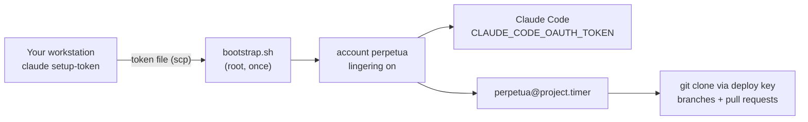

# Running on a VPS

A small Linux server is the natural home for Perpetua: always on, no laptop lid to close, no WSL keep-alive. This guide takes a fresh Debian, Ubuntu or Fedora-family VPS to a running cadence in about ten minutes.



## What the server needs

| Need | How Perpetua handles it |
| --- | --- |
| Something to start sessions with nobody logged in | systemd user timers with lingering, enabled by the bootstrap |
| A Claude login without a browser | `claude setup-token` on a machine with a browser, stored in `~/.config/perpetua/environment` (mode 600), exported by the runner to every session |
| Push access to your repositories, and nothing else | A per-server SSH key, added as a **deploy key** on each repository |
| Isolation from everything else on the host | A dedicated Unix account (`perpetua` by default) that owns only its clones |

Sizing: 2 vCPU and 4 GB of RAM are enough for Claude Code itself. Size up for what your project's own build and test suite need, since the agent runs them.

## 1. Get a Claude token on your workstation

```bash
claude setup-token
```

It opens the browser login and prints a long-lived token tied to your subscription. Save it to a file and copy it to the server; never paste it on a command line, where it would land in shell history and in the process list.

```bash
umask 077; cat > claude-token        # paste, then Ctrl-D
scp claude-token root@vps:/root/claude-token
```

!!! warning "One account, one quota"
    Every server that uses the same token draws on the same subscription limits. When the limit is reached, the back-off gate pauses each project for `BACKOFF_SECONDS`. Spread projects across servers rather than running many sessions in parallel on one account, and give each server its own token so you can revoke one without stopping the others.

## 2. Copy Perpetua to the server and bootstrap it

```bash
scp perpetua-1.1.0.tar.gz root@vps:
ssh root@vps
tar -xzf perpetua-1.1.0.tar.gz && cd perpetua-1.1.0
./platform/vps/bootstrap.sh --oauth-token-file /root/claude-token \
    --repo git@github.com:you/atlas.git
shred -u /root/claude-token
```

The bootstrap is idempotent. In order, it:

1. installs `git`, `curl`, `python3`, `util-linux`, `coreutils` and, when available, `gh`;
2. creates the `perpetua` account and enables lingering for it;
3. copies root's `authorized_keys` to it, so you can `ssh perpetua@vps`;
4. generates `~/.ssh/id_ed25519` for it and trusts the GitHub and GitLab host keys;
5. sets a git identity for the agent's commits (`--git-name`, `--git-email`);
6. installs Claude Code with the official installer, then Perpetua and the bundled `autonomous-mode` skill into `~/.local`;
7. stores the token in `~/.config/perpetua/environment`, mode 600;
8. with `--repo`, clones the repository into `~/work/NAME` and runs `perpetua init`;
9. with `--enable`, starts the cadence (`--interval`, default `30min`).

Run it with `--dry-run` first to see every command without changing anything. `--help` lists all options.

## 3. Grant repository access

The bootstrap prints the account's public key. Add it to each repository as a deploy key **with write access** (GitHub: *Settings, Deploy keys*). A deploy key reaches one repository only, which keeps the blast radius small. If the clone failed because the key was not there yet, run the bootstrap again.

For the agent to open pull requests, log the account into the GitHub CLI with a fine-grained token limited to those repositories:

```bash
ssh perpetua@vps
gh auth login
```

Protect the default branch on the hosting side (required pull request and green checks). The directive already forbids pushing to it; branch protection makes that a hard rule.

## 4. First supervised session, then the cadence

```bash
ssh perpetua@vps
perpetua doctor                       # credentials, lingering, units
$EDITOR ~/work/atlas/.perpetua/directive.md
perpetua run atlas --force            # watch one session end to end
perpetua enable atlas --interval 30min
```

On a server nobody uses Claude Code interactively, so the presence gate never closes. You can leave `PRESENCE_WINDOW_MIN` as is, or set it to `0`.

## Operating a fleet

- **One project, one server** at a time. The lock is per host: two servers on the same repository would work on the same plan concurrently.
- **Reports**: `POST_SESSION_HOOK` can post each outcome to a chat webhook, see [Notifications](notifications.md).
- **Upgrades**: copy the new archive and run the bootstrap again, or `./install.sh --prefix ~/.local` as the account.
- **Stop everything on a server**: `perpetua pause NAME` for each project, or `systemctl --user stop 'perpetua@*.timer'`.
- **Revoke access**: remove the deploy key, revoke the GitHub token, and revoke the Claude token from your Claude account settings, then delete `~/.config/perpetua/environment`.

Read the [threat model](../security/threat-model.md) before pointing a server at anything that holds production credentials.
