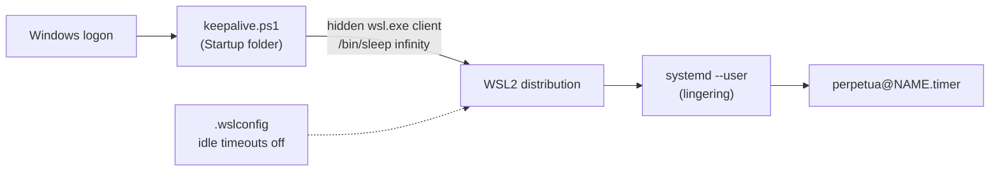

# Running on WSL

Perpetua runs on WSL2 with systemd enabled. The loop it was extracted from runs on WSL2 to this day. The difficulty is not Perpetua: it is that Windows stops a WSL distribution when it believes nobody uses it, and stops everything when the PC sleeps. This guide closes each of those gaps.



| Gap | What happens | Fix |
| --- | --- | --- |
| systemd off | No user instance, no timers | `systemd=true` in `/etc/wsl.conf` |
| Idle shutdown | Windows stops the distribution, then the VM, some seconds after the last WSL client exits | `.wslconfig` timeouts, plus a keep-alive client |
| No logged-in session | The user instance stops with the last session | `loginctl enable-linger` |
| Sleep | Windows suspends the VM; timers do not fire | Disable sleep on AC power |

## 1. Enable systemd in the distribution

Inside WSL:

```bash
cat /etc/wsl.conf
```

If it does not already contain the following, add it:

```ini title="/etc/wsl.conf"
[boot]
systemd=true
```

```bash
sudo tee -a /etc/wsl.conf > /dev/null <<'EOF'
[boot]
systemd=true
EOF
```

Then restart WSL from PowerShell (step 2 does it too, you can do both at once).

## 2. Turn off the idle timeouts

In Windows, create or edit `%UserProfile%\.wslconfig`:

```ini title="%UserProfile%\.wslconfig"
[wsl2]
vmIdleTimeout=-1

[general]
instanceIdleTimeout=-1
```

From PowerShell:

```powershell
notepad "$env:USERPROFILE\.wslconfig"
```

Apply it by shutting WSL down completely; it restarts on the next `wsl` command:

```powershell
wsl --shutdown
wsl -l -v
```

`wsl -l -v` also gives the exact name of your distribution (`Ubuntu`, `Ubuntu-24.04`, `Debian`...), which the next step needs.

## 3. Install the keep-alive client

Even with the timeouts off, Windows can still stop a distribution that has no client attached. `platform/wsl/keepalive.ps1` keeps one invisible client running: a hidden `wsl.exe` that runs `/bin/sleep infinity` in your distribution, restarted 30 seconds after it ever exits. A global mutex (`Global\PerpetuaWslKeepalive`) makes sure only one copy runs, however many times it is started.

`platform/wsl/install-keepalive.ps1` installs it: it copies `keepalive.ps1` to `%LOCALAPPDATA%\Perpetua`, creates a hidden-window shortcut named *Perpetua WSL keep-alive* in your Windows Startup folder so it starts at every logon, and starts it immediately.

In PowerShell (no administrator rights needed):

```powershell
$tmp = Join-Path $env:TEMP "perpetua-wsl"
New-Item -ItemType Directory -Force -Path $tmp | Out-Null
foreach ($f in 'keepalive.ps1', 'install-keepalive.ps1') {
    Invoke-WebRequest -UseBasicParsing `
        -Uri "https://raw.githubusercontent.com/koffih/perpetua/main/platform/wsl/$f" `
        -OutFile "$tmp\$f"
}

# Distro: the name shown by wsl -l -v
powershell -NoProfile -ExecutionPolicy Bypass -File "$tmp\install-keepalive.ps1" -Distro Ubuntu
```

```text
Perpetua WSL keep-alive installed and started.
Recommended in %USERPROFILE%\.wslconfig, then run: wsl --shutdown
  [wsl2]
  vmIdleTimeout=-1
  [general]
  instanceIdleTimeout=-1
```

`-Distro` is optional: without it, the keep-alive attaches to your default distribution. Name it explicitly if you have more than one.

!!! tip "From a clone"
    If you cloned the repository inside WSL, the two scripts are already in `platform/wsl/`. Copy them to a Windows drive first (for example `cp platform/wsl/*.ps1 /mnt/c/Users/YOU/Downloads/`), then run `install-keepalive.ps1` from there. The installer copies `keepalive.ps1` from its own folder into `%LOCALAPPDATA%\Perpetua`, so the Startup shortcut never depends on WSL being up.

To remove it later: the uninstaller deletes the shortcut, stops the running keep-alive and removes `%LOCALAPPDATA%\Perpetua`.

```powershell
powershell -NoProfile -ExecutionPolicy Bypass -File "$env:TEMP\perpetua-wsl\install-keepalive.ps1" -Uninstall
```

If the temporary copy is gone, download `install-keepalive.ps1` again as above.

## 4. Enable lingering

Inside WSL, so that your systemd user instance and its timers keep running with no shell open:

```bash
loginctl enable-linger "$USER"
```

## 5. Keep Windows awake

When Windows sleeps or hibernates, the WSL VM is suspended with it, and no setting inside WSL changes that. On a machine meant to work overnight, disable sleep on AC power. In PowerShell:

```powershell
powercfg /change standby-timeout-ac 0
powercfg /change hibernate-timeout-ac 0
```

Or in **Settings > System > Power & battery > Screen, sleep & hibernate timeouts**, set *When plugged in, put my device to sleep after* to **Never**. Turning the screen off is fine.

!!! warning "Laptops"
    Closing the lid usually triggers sleep regardless of the timeout. Set *When I close the lid* to *Do nothing* for *Plugged in* in the Control Panel power options, or leave the lid open. On battery, Windows will still sleep; Perpetua resumes on the first timer tick after wake-up.

## 6. Verify

Inside WSL:

```bash
perpetua doctor
```

```text
==> Perpetua 1.0.0
  ✓ Claude Code 2.1.0 (Claude Code)
  ✓ Claude credentials present
  ✓ autonomous-mode skill installed
  ✓ python3 3.12.3
  ✓ flock
  ✓ timeout
  ✓ find
  ✓ systemd user instance
  ✓ lingering enabled
  ✓ WSL keep-alive client detected
  ✓ units installed in /home/dev/.config/systemd/user

==> Host ready
```

`doctor` recognises WSL from `/proc/version` and looks for a running `sleep infinity` process. Without one, it warns `WSL without keep-alive` and links to this page.

The real test is a night: enable a project, leave the PC plugged in and locked, and check in the morning that `perpetua logs NAME` shows wake-ups every interval through the night, and `uptime` inside WSL shows no restart.

## Troubleshooting

| Symptom | Check |
| --- | --- |
| `systemd user instance unavailable` | `ps -p 1 -o comm=` must print `systemd`. If not, step 1, then `wsl --shutdown`. |
| Gaps of several hours in `runner.log` | Windows slept (Event Viewer, *System* log, source *Kernel-Power*), or the keep-alive was not running. |
| `uptime` in WSL is shorter than expected | The distribution was stopped: check the keep-alive with `pgrep -af 'sleep infinity'` and the `.wslconfig` timeouts. |
| Sessions fail with `outcome=error` right after Windows updates | WSL may have been updated and restarted; run `perpetua doctor` and one `perpetua run NAME --force`. |
