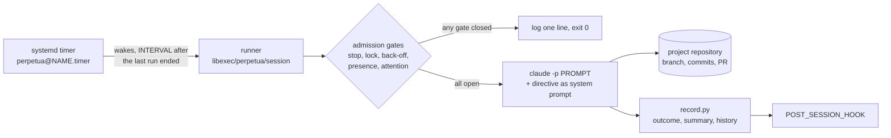

<div class="pp-hero" markdown>

{ .pp-hero__logo }

<h1>Your plan keeps moving<br><span class="pp-hero__gradient">while you are away</span></h1>

<p class="pp-hero__subtitle">Perpetua runs unattended Claude Code sessions on a project, one after another, from a systemd user timer. Every session is gated, bounded in time, recorded and reviewable in the morning.</p>

<div class="pp-hero__actions" markdown>
[Get started](getting-started/quickstart.md){ .md-button .md-button--primary }
[How it works](concepts/architecture.md){ .md-button }
</div>

<p class="pp-hero__install"><code>curl -fsSL https://raw.githubusercontent.com/koffih/perpetua/main/install.sh | bash</code></p>

</div>

Perpetua is a small, dependency-free runner (bash, Python standard library, systemd) extracted from a loop that has driven a large multi-repository codebase in production since October 2026. It does one thing: wake up, decide whether a session may start, run `claude -p` with your standing directive, record what happened, and get out of the way.

<div class="pp-terminal" markdown>
<div class="pp-terminal__bar"><span></span><span></span><span></span><em>perpetua status</em></div>

```text
$ perpetua status acme-api
acme-api
  project        /home/dev/src/acme-api
  cadence        enabled, next Tue 2026-10-20 22:41:12
  state          ready
  last session   ok (2026-10-20T21:12:03+02:00)
  last wake-up   2026-10-20 22:26:12 session:end 20261020T211203 outcome=ok exit=0 duration=74min
```

</div>

## Why Perpetua

<div class="grid cards" markdown>

-   :material-refresh:{ .lg .middle } __Fresh context, every session__

    ---

    Each session starts from a clean context and rebuilds its picture from the plan, the progress notes and the repository. No drift, no context rot, nothing hidden in memory.

    [:octicons-arrow-right-24: Session lifecycle](concepts/session-lifecycle.md)

-   :material-shield-check-outline:{ .lg .middle } __Fail-closed gates__

    ---

    Five admission gates (stop flag, lock, back-off, operator presence, pending question) run before every session. Any doubt means no session, and the cadence carries on.

    [:octicons-arrow-right-24: Guardrails](concepts/guardrails.md)

-   :material-account-clock-outline:{ .lg .middle } __Yields to the operator__

    ---

    If you used Claude Code in the last ten minutes, Perpetua stands down. You and the agent never edit the same files at the same time.

    [:octicons-arrow-right-24: Operator presence](concepts/guardrails.md#gate-4-operator-presence)

-   :material-timer-cog-outline:{ .lg .middle } __No daemon__

    ---

    systemd owns the schedule. The runner is a short-lived process that exits after every wake-up. Logs go to a plain file and to journald.

    [:octicons-arrow-right-24: Architecture](concepts/architecture.md)

-   :material-key-outline:{ .lg .middle } __Works on a subscription__

    ---

    Perpetua drives the Claude Code CLI you are already logged into. No API key is required, and usage limits trigger an automatic back-off.

    [:octicons-arrow-right-24: Installation](getting-started/installation.md)

-   :material-file-document-check-outline:{ .lg .middle } __Reviewable by design__

    ---

    Every session leaves a machine record, a human summary, a full stream-json journal and a line in the runner log. Branches and pull requests carry the work itself.

    [:octicons-arrow-right-24: Operating Perpetua](guides/operating.md)

</div>

## How it works in 60 seconds



1. **You register a project.** `perpetua init` writes a configuration file under `~/.config/perpetua/projects/` and scaffolds `.perpetua/directive.md` in the repository: the standing order every session receives.
2. **systemd wakes the runner.** A user timer fires a fixed delay after the previous run ended (15 minutes by default), so sessions never overlap and never pile up.
3. **The gates decide.** Paused? Already running? Recently rate limited? Are you at the keyboard? Is a question waiting for you? If any answer says no, the runner logs one line and exits 0.
4. **A session runs.** `claude -p` starts in the project directory with your prompt, your directive appended to the system prompt, and a hard time limit (`MAX_SESSION`, 4 hours by default).
5. **The outcome is recorded.** `ok`, `error`, `timeout`, `rate_limited` or `interrupted`, with turns, cost, duration and the agent's closing report. A usage limit sets a back-off; your hook can notify you.
6. **You review in the morning.** `perpetua status`, `perpetua summaries`, and the pull requests the agent opened. The work merges only when you and your CI agree.

## Next steps

<div class="grid cards" markdown>

-   :material-download-outline:{ .lg .middle } __Install__

    ---

    Requirements, the one-line installer, and `perpetua doctor`.

    [:octicons-arrow-right-24: Installation](getting-started/installation.md)

-   :material-rocket-launch-outline:{ .lg .middle } __Quickstart__

    ---

    From `init` to a first supervised session and an overnight cadence.

    [:octicons-arrow-right-24: Quickstart](getting-started/quickstart.md)

-   :material-script-text-outline:{ .lg .middle } __Write a directive__

    ---

    The standing order that makes unattended work safe and useful.

    [:octicons-arrow-right-24: Writing a directive](guides/writing-a-directive.md)

-   :material-console:{ .lg .middle } __Reference__

    ---

    Every command, configuration key, file and log line.

    [:octicons-arrow-right-24: CLI reference](reference/cli.md)

</div>
