# systemd units

Perpetua does not run a daemon. Each project is driven by two instances of template units in the systemd **user** manager:

| Unit | Role |
| --- | --- |
| `perpetua@<name>.timer` | Wakes the runner a fixed delay after the previous run ended. |
| `perpetua@<name>.service` | Runs one wake-up of the runner: gates, then at most one session. |

The templates are installed in `~/.local/share/perpetua/systemd/`. `perpetua enable` renders them into `~/.config/systemd/user/` and starts the timer instance. Why systemd timers rather than a daemon, cron or a supervisor: [ADR 0002](../adr/0002-systemd-user-timers.md).

## perpetua@.service

```ini title="share/perpetua/systemd/perpetua@.service"
# Perpetua: one unattended Claude Code session for the project named by the instance.
# Rendered by `perpetua enable`; @LIBEXECDIR@ is replaced with the installed path.
[Unit]
Description=Perpetua autonomous session for %i
Documentation=https://github.com/koffih/perpetua
After=network-online.target
Wants=network-online.target

[Service]
Type=oneshot
ExecStart=@LIBEXECDIR@/session %i
# The runner enforces MAX_SESSION itself; systemd must never cut it short.
TimeoutStartSec=infinity
KillMode=mixed
Nice=5
IOSchedulingClass=best-effort
IOSchedulingPriority=6
```

**`[Unit]` section**

`Description=Perpetua autonomous session for %i`
:   `%i` is the instance name, which is the project name: `perpetua@shop.service` describes itself as `Perpetua autonomous session for shop`.

`Documentation=`
:   Shown by `systemctl status`.

`After=network-online.target`, `Wants=network-online.target`
:   Order the start after the network is reported online and pull in the target. In the user manager this target is often not tied to the system's real network state; the runner does not depend on it, and a session started without connectivity ends as `error` and is retried at the next wake-up.

**`[Service]` section**

`Type=oneshot`
:   The service runs one process to completion. It is `activating` for the whole run and returns to `inactive` (or `failed`) when the runner exits; it never becomes `active`. This end-of-run transition is what the timer's `OnUnitInactiveSec` counts from.

`ExecStart=@LIBEXECDIR@/session %i`
:   `@LIBEXECDIR@` is replaced by `perpetua enable` with the absolute runner directory, `~/.local/libexec/perpetua` by default (or `PERPETUA_LIBEXEC`). The runner receives the project name as its only argument: timer-driven runs never use `--force`.

`TimeoutStartSec=infinity`
:   Without this line, a `oneshot` service is killed after `DefaultTimeoutStartSec` (90 seconds by default) of activation. Sessions last hours, and the runner already bounds them with `timeout MAX_SESSION` plus a 60-second kill grace, so systemd must not impose a second, shorter ceiling.

`KillMode=mixed`
:   On stop, `SIGTERM` goes to the runner only. The runner forwards it to Claude Code through `timeout`, waits for the session to exit, records it as `interrupted` and exits. Once the runner has exited, every process still left in the unit receives `SIGKILL`; if the runner has not exited within the stop timeout (`TimeoutStopSec`, 90 seconds by default), everything is killed and no record is written. The same final cleanup applies at the normal end of a run, so processes the agent started in the background (a development server, a watcher) do not outlive the session.

`Nice=5`
:   Lower CPU priority than interactive work, so a session running alongside the operator does not degrade the desktop.

`IOSchedulingClass=best-effort`, `IOSchedulingPriority=6`
:   Best-effort I/O class at priority 6 (0 is highest, 7 lowest), for the same reason.

The service declares no `[Install]` section: it is started only by its timer, or by hand.

The service runs with the user manager's environment, not your shell's. Inspect it with `systemctl --user show-environment`. The runner prepends the usual user binary directories to `PATH` itself; anything else Claude Code needs (proxy settings, for instance) must be in the manager's environment, for example through `~/.config/environment.d/*.conf`.

## perpetua@.timer

```ini title="share/perpetua/systemd/perpetua@.timer"
# Perpetua cadence: wake the runner a fixed delay after the previous run ended.
# Per-project interval: drop-in written by `perpetua enable --interval`.
[Unit]
Description=Perpetua cadence for %i
Documentation=https://github.com/koffih/perpetua

[Timer]
OnBootSec=10min
OnUnitInactiveSec=15min
AccuracySec=30s
Persistent=false

[Install]
WantedBy=timers.target
```

**`[Timer]` section**

`OnBootSec=10min`
:   First wake-up 10 minutes after boot, leaving time for the desktop, the network and the operator to settle. When the timer is started and boot is already more than 10 minutes in the past, systemd elapses it immediately: see [first wake-up](#first-wake-up).

`OnUnitInactiveSec=15min`
:   Every following wake-up happens 15 minutes after `perpetua@<name>.service` last became inactive, that is after the previous run ended. The unit triggered is the service of the same instance name (`perpetua@shop.timer` starts `perpetua@shop.service`).

`AccuracySec=30s`
:   systemd may delay an elapse by up to 30 seconds to coalesce wake-ups. The default, one minute, would be acceptable too; 30 seconds keeps the log timestamps close to the configured interval.

`Persistent=false`
:   Explicit for readers: `Persistent=` applies only to `OnCalendar=` timers, and no missed run is ever caught up.

**`[Install]` section**

`WantedBy=timers.target`
:   `perpetua enable` runs `systemctl --user enable --now`, which links the instance into `timers.target.wants/` so that it starts with the user manager.

### Why OnUnitInactiveSec

`OnUnitInactiveSec` measures the interval from the **end** of the previous run, whereas `OnUnitActiveSec` or `OnCalendar` measure from the start or the wall clock.

- Sessions last from seconds (a closed gate) to hours (a full session). Counting from the end guarantees a rest period between two sessions, whatever their length.
- A calendar or start-relative schedule could elapse while a session is still running. systemd does not start an already running unit again, so the elapse would be lost and the schedule would drift relative to the work anyway.
- After a usage limit, the next wake-ups land 15 minutes apart, which bounds the cost of polling the back-off gate.

### Interval drop-in

`perpetua enable <name> --interval 30min` writes:

```ini title="~/.config/systemd/user/perpetua@shop.timer.d/10-interval.conf"
[Timer]
OnUnitInactiveSec=
OnUnitInactiveSec=30min
```

The empty assignment clears the template's `15min`; without it, both values would apply and the timer would elapse at whichever comes first. `OnBootSec=10min` is unchanged. The drop-in is specific to one instance, so projects can have different intervals.

Accepted values match `^[0-9]+(s|min|h)?$`. A bare number is in seconds. To set another systemd time span, such as `1h 30min`, write the drop-in by hand and run `systemctl --user daemon-reload`.

The drop-in is deleted by `perpetua remove` and by `install.sh --uninstall`, not by `perpetua disable`, and not by `perpetua enable` without `--interval`.

## Cadence behaviour

### First wake-up

| Situation when the timer starts | First wake-up |
| --- | --- |
| `perpetua enable`, host up for more than 10 minutes | Immediately |
| `perpetua enable`, host up for less than 10 minutes | 10 minutes after boot |
| Login or boot with the timer enabled (and lingering on) | 10 minutes after boot |

Before its first run the service has never been inactive after activity, so `OnUnitInactiveSec` has no reference point and only `OnBootSec` can elapse. From then on, both apply.

### Skips keep the cadence

A wake-up that ends at a gate takes a fraction of a second. The service becomes inactive and the next wake-up is one interval later. While a gate stays closed (operator present, back-off, pause), the runner therefore polls it once per interval and logs one line each time.

```mermaid
gantt
    dateFormat HH:mm
    axisFormat %H:%M
    section perpetua@shop
    session (ok)               :done, s1, 06:40, 132m
    wait 15 min                :w1, after s1, 15m
    presence gate closed       :milestone, g1, after w1, 0m
    wait 15 min                :w2, after w1, 15m
    presence gate closed       :milestone, g2, after w2, 0m
    wait 15 min                :w3, after w2, 15m
    session (rate_limited)     :crit, s2, after w3, 101m
    wait 15 min                :w4, after s2, 15m
    back-off gate closed       :milestone, g3, after w4, 0m
```



Every gate exits with status `0` precisely so that skips are ordinary, successful runs ([ADR 0006](../adr/0006-fail-closed-gates.md)).

### Failures keep the cadence

A runner exit status of `2` or `3` (configuration error, missing project directory, `CLAUDE_BIN` not found) marks the service `failed`. `OnUnitInactiveSec` counts from entering `failed` as well, so the timer keeps firing. Failed instances are listed by:

```bash
systemctl --user --failed
```

`systemctl --user reset-failed 'perpetua@*'` clears the state once the cause is fixed.

### Suspend, shutdown and logout

- The monotonic clock used by these timers stops during suspend: a laptop suspended for an hour adds an hour to the current interval.
- After a reboot, the cadence restarts with `OnBootSec=10min`. Nothing is caught up.
- Without lingering, the user manager stops at logout, interrupting any running session (outcome `interrupted`). See [Lingering](#lingering).

### Manual runs and the timer

`perpetua run <name>` executes the runner directly, outside systemd. The timer does not know about it: its next elapse is unchanged, and if that elapse happens during the manual session, the timer-driven run ends at `gate:lock`.

To run a wake-up through systemd, which also resets the interval:

```bash
systemctl --user start --no-block perpetua@shop.service
```

Without `--no-block`, `systemctl start` waits until the oneshot service finishes, which can be hours.

## Stopping a running session

| Goal | Command | Effect on the running session |
| --- | --- | --- |
| No new session, let the current one finish | `perpetua pause shop` | None |
| Stop the cadence, let the current one finish | `perpetua disable shop` | None |
| Interrupt now | `systemctl --user stop perpetua@shop.service` | Claude Code receives `SIGTERM`; the session is recorded with outcome `interrupted` and exit code `130`. Work not committed by the agent stays in the working tree. If Claude Code does not exit within 90 seconds, systemd kills the unit and no record is written. |

The service ends successfully after an interruption, so the timer schedules the next wake-up as usual. Combine the stop with `perpetua pause` or `perpetua disable` to prevent it.

## Lingering

The user manager normally runs only while the user has a session open. To keep timers running after logout and to start them at boot:

```bash
loginctl enable-linger "$USER"
loginctl show-user "$USER" -p Linger   # Linger=yes
```

`perpetua enable` warns and `perpetua doctor` reports when lingering is off. On WSL, lingering is not enough on its own, because the distribution itself stops when no client is attached; `perpetua doctor` looks for a keep-alive process (`sleep infinity`).

## Logs in journald

The runner writes its log lines to standard error as well as to `runner.log`, so the journal holds the same events, with systemd's own start, stop and failure messages around them:

```bash
journalctl --user -u perpetua@shop.service            # one project, all time
journalctl --user -u perpetua@shop.service -f         # follow
journalctl --user -u 'perpetua@*' --since today       # all projects
journalctl --user -u perpetua@shop.timer              # timer start and stop
```

The agent's own output never reaches the journal: it goes to the session journal in the state directory. On systems where the user journal is not persistent, these entries are lost at reboot; `runner.log` is not.

## Useful commands

```bash
# Next elapse of every Perpetua timer
systemctl --user list-timers 'perpetua@*'

# Timer and service state for one project
systemctl --user status perpetua@shop.timer perpetua@shop.service

# Effective unit, with drop-ins
systemctl --user cat perpetua@shop.timer

# Is a session running? (prints "activating" during a session)
systemctl --user is-active perpetua@shop.service

# Run one wake-up through systemd now, without waiting for it
systemctl --user start --no-block perpetua@shop.service

# Reload after editing a drop-in by hand
systemctl --user daemon-reload
```

## Customising the units

`perpetua enable` overwrites the rendered template units each time it runs. Put customisations in drop-ins, which it never touches (apart from `10-interval.conf`):

```ini title="~/.config/systemd/user/perpetua@.service.d/20-limits.conf"
[Service]
MemoryMax=8G
CPUQuota=200%
```

A drop-in in `perpetua@.service.d/` applies to every project; one in `perpetua@shop.service.d/` to a single project. Resource-control directives require the relevant controllers to be delegated to the user manager, which is the default on most current distributions. Run `systemctl --user daemon-reload` after any change.
